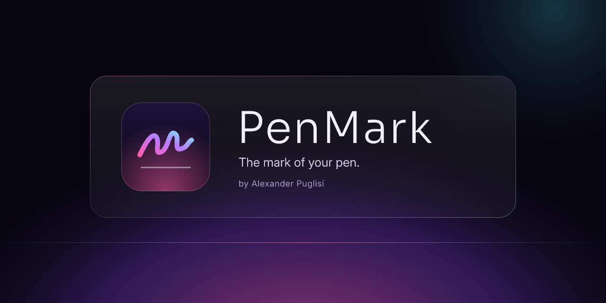
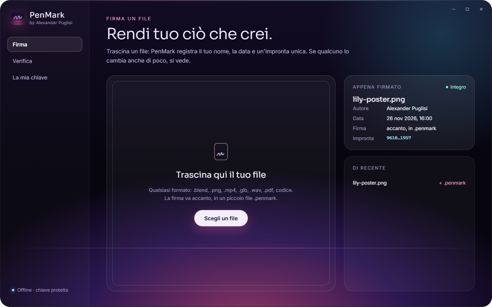
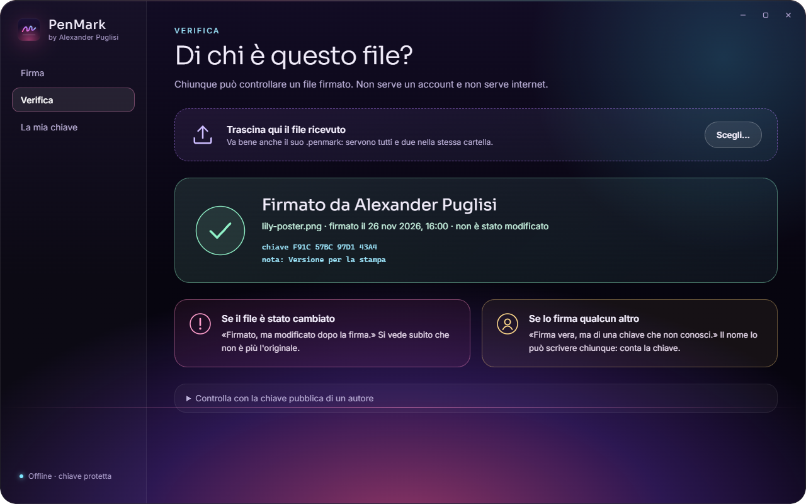
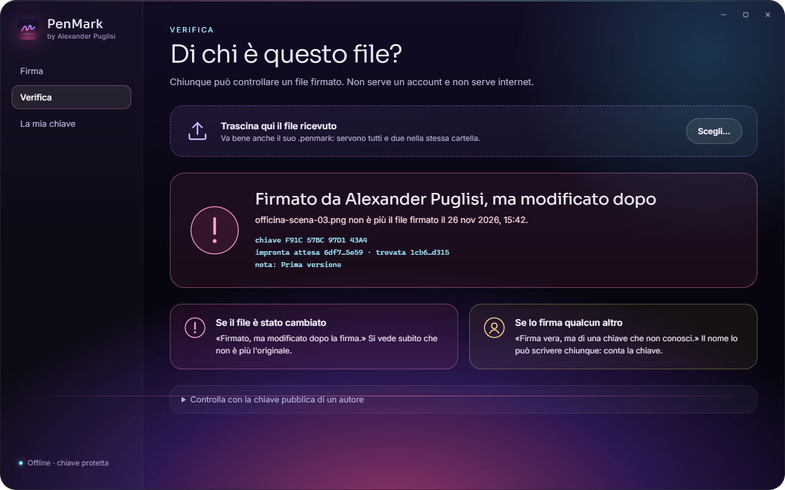

<p align="center"></p>

<p align="center">
  <a href="https://github.com/AlexanderPuglisi/penmark/actions/workflows/ci.yml"></a>
  
  
  <a href="LICENSE"></a>
</p>

# PenMark

**The mark of your pen.** Sign what you create — 3D models, images, video, audio, documents and code — and prove it is yours and since when.

by Alexander Puglisi

> Status: early development. Nothing to download yet: the first release will come with a signed installer.

<p align="center">
  
  
</p>
<p align="center">
  
</p>
<p align="center"><sub>Real screenshots of the app on Windows 11.</sub></p>

## What it does

- **Sign a file.** PenMark hashes the whole saved file and signs it with your own key. The signature sits next to it in a small `.penmark` file; signing inside the file with Content Credentials (C2PA) is coming for the formats that support it.
- **Verify a file.** Anyone can check a signed file, offline, without an account: valid, changed after signing, signed by an unknown key, or forged.
- **Keep your key safe.** Your private key never leaves your PC and is encrypted with your Windows account. It is never overwritten.
- **Collect nothing.** No account, no analytics, no network. See [PRIVACY.md](PRIVACY.md).

A signature is proof, not a lock: it shows who signed a file and when, it does not stop copies. A screenshot does not carry the signature with it.

## How it works, with a cube from Blender

1. You save `cube.blend` and drop it on PenMark.
2. PenMark reads the whole saved file and computes its SHA-256 fingerprint.
3. It signs the fingerprint, your name and the date with your Ed25519 key and writes `cube.blend.penmark` next to it.
4. You send both files. The receiver drops them on PenMark (or runs `penmark verify cube.blend`).
5. If even one byte of the cube changed, the fingerprint no longer matches and PenMark says so.

The date comes from your PC clock, which can be set wrong on purpose. An optional trusted timestamp (RFC 3161) is planned for when you need a date others can rely on.

## Verify from the terminal

```text
penmark verify cube.blend --trust <author public key>
```

Exit codes: `0` valid · `1` unknown key · `2` file changed · `3` forged · `4` error.

## Build from source

Needs Rust (stable) on Windows 10 or 11 with WebView2.

```text
cargo test
cargo run -p penmark-app
```

## In italiano

**Il segno della tua penna.** Firma quello che crei — modelli 3D, immagini, video, audio, documenti e codice — e dimostra che è tuo e da quando esiste. Funziona senza internet, la chiave resta sul tuo PC, cifrata con il tuo account Windows, e PenMark non raccoglie dati di nessuno.

Stato: in sviluppo, ancora niente da scaricare.

## License

Apache License 2.0 — see [LICENSE](LICENSE) and [NOTICE](NOTICE).
The bundled fonts Sora and Inter are under the SIL Open Font License 1.1 (see `assets/fonts`).
